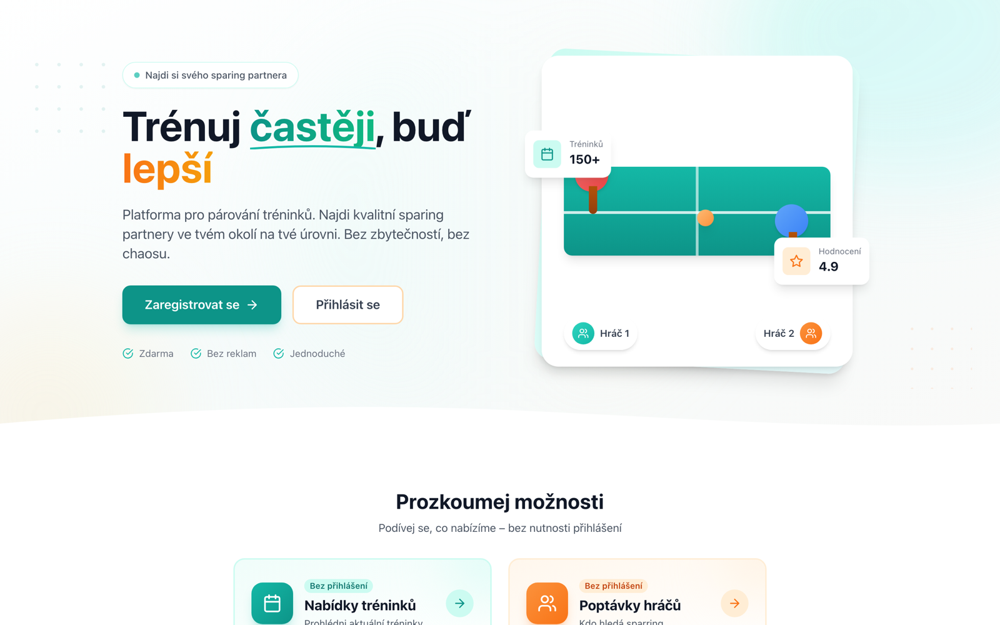
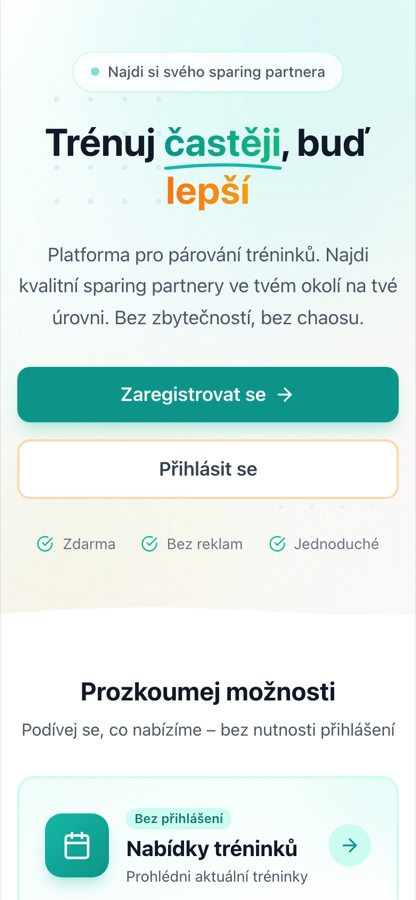

<div align="center">

# Ping Sparring

**Find a table tennis sparring partner at your level, near you.**

[](LICENSE)




</div>

> [!WARNING]
> **This project is not maintained or developed anymore.** It was only a proof of concept: a
> quick try at whether table tennis sparring could be matched automatically. The code is shared
> as it is, with no support, no releases and no plans for new features.

Ping Sparring (in the app: **Můj trénink**, "my training") is a web platform that matches
table tennis players with training sessions. Clubs and coaches post sessions, players post
what they are looking for, and the app suggests good matches based on skill (ELO rating) and
region. It is built for the Czech table tennis scene, so the user interface is in Czech.

## Features

- **Matching by level and region** — recommendations are scored by how well a player's ELO
  rating fits a session's ELO range, filtered by Czech districts and regions.
- **Training sessions** — one-off or weekly recurring sessions with a capacity, a place, an
  ELO range and a day and time.
- **Training requests** — players can post that they are looking for a sparring partner, and
  organizers can browse those requests.
- **Registrations** — sign-ups are approved automatically or by hand, per session.
- **Waitlist** — when a session is full, players join a waitlist and move up when a spot
  frees.
- **Reputation** — late cancellations and no-shows lower a player's reliability score; the later the cancellation, the bigger the penalty.
- **Notifications** — in-app and email (Resend or SMTP).
- **Accounts** — email verification, password reset, JWT authentication.
- **Browse without an account** — sessions and player requests are visible before you sign up.

## Screenshots

| Landing page (desktop) | Landing page (mobile) |
| --- | --- |
|  |  |

The landing page says "Train more often, get better". It leads with sign-up and log-in, then
"Explore the options": training offers and player requests you can browse without logging in.
The layout works on phones too.

## Tech stack

| Part      | Technology                                                  |
| --------- | ----------------------------------------------------------- |
| Backend   | Python 3.11+, FastAPI, SQLAlchemy 2.0 (async), Alembic       |
| Database  | PostgreSQL                                                  |
| Frontend  | React 18, TypeScript, Vite, Tailwind CSS                    |
| Auth      | JWT                                                         |
| Email     | Resend, with SMTP as a fallback (or console output for dev) |
| Hosting   | Docker; deployed on Render                                  |

```
ping-sparring/
├── backend/
│   ├── app/
│   │   ├── api/v1/      # REST endpoints
│   │   ├── core/        # config, database, security, seed data
│   │   ├── models/      # SQLAlchemy models
│   │   ├── schemas/     # Pydantic schemas
│   │   └── services/    # matching, reputation, notifications, email
│   └── alembic/         # database migrations
├── frontend/
│   └── src/             # pages, components, hooks, API client, types
├── docker-compose.yml
└── docker-compose.prod.yml
```

## Getting started

### Requirements

- Docker and Docker Compose
- For local development without Docker: Python 3.11+ with Poetry, and Node.js 20+

### Run with Docker Compose

```bash
git clone https://github.com/romanzdk/ping-sparring.git
cd ping-sparring
cp .env.example .env            # then edit the values
docker-compose up -d
docker-compose exec backend alembic upgrade head      # database migrations
docker-compose exec backend python -m app.core.seed   # Czech districts and regions
```

| Service      | URL                          |
| ------------ | ---------------------------- |
| Frontend     | http://localhost:5173        |
| Backend API  | http://localhost:8000        |
| API docs     | http://localhost:8000/docs   |

### Configuration

The main settings in `.env` (see `.env.example` for all of them):

| Variable         | Meaning                                                   |
| ---------------- | --------------------------------------------------------- |
| `DATABASE_URL`   | PostgreSQL connection string                              |
| `SECRET_KEY`     | JWT signing key — generate one with `openssl rand -hex 32` |
| `EMAIL_PROVIDER` | `resend`, `smtp` or `console` (prints emails to the log)  |
| `RESEND_API_KEY` | Needed when `EMAIL_PROVIDER=resend`                       |
| `SMTP_*`         | Needed when `EMAIL_PROVIDER=smtp` (port 587 STARTTLS, 465 TLS) |

### Local development

Backend:

```bash
cd backend
poetry install
poetry run alembic upgrade head
poetry run python -m app.core.seed
poetry run uvicorn app.main:app --reload
```

Frontend:

```bash
cd frontend
npm install
npm run dev
```

### Production build

```bash
docker-compose -f docker-compose.prod.yml up -d
docker-compose -f docker-compose.prod.yml exec backend alembic upgrade head
```

## API overview

The full, interactive API reference is at `/docs` on a running backend. The main groups:

| Group             | Examples                                                                 |
| ----------------- | ------------------------------------------------------------------------ |
| Auth              | register, login, verify email, forgot / reset password, current user     |
| Trainings         | list with filters, detail, create, edit, cancel                         |
| Training requests | players looking for a partner                                           |
| Registrations     | sign up, cancel, approve, reject, join the waitlist                      |
| Matching          | recommended sessions for a player, suitable players for a session        |
| Notifications     | list, mark as read                                                      |
| Regions           | Czech districts and regions                                              |

## Contributing

The project is not maintained, so issues and pull requests will probably not get a reply.
Feel free to fork it and build on it. If you do send a change:

1. Fork the repo and create a branch.
2. Keep the change small and focused.
3. Check the frontend with `npm run lint` (in `frontend/`) and make sure the app still starts
   with Docker Compose.
4. Open a pull request that explains what changed and why.

Ideas that were never done: filtering by distance from an address, sign-in with Google and
other providers, and an admin area.

## License

[MIT](LICENSE) © Roman Žydyk
